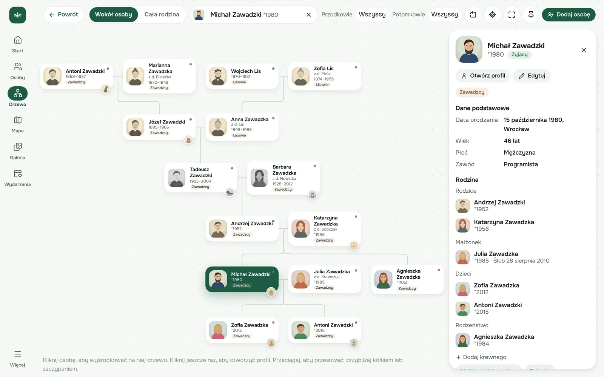
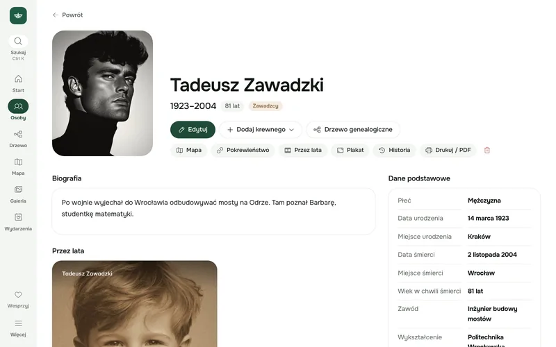
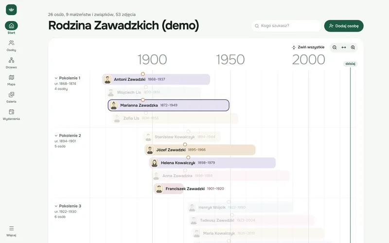
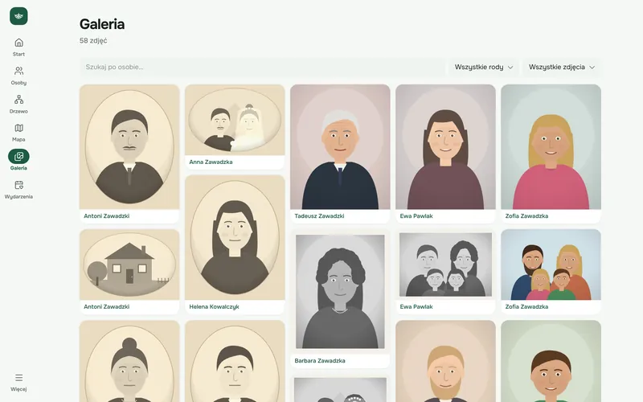

<p align="center">
  
</p>

<h1 align="center">MyRoots</h1>

<p align="center">
  Drzewo genealogiczne, zdjęcia i historie rodziny na Twoim własnym urządzeniu.<br>
  macOS, Windows, Linux, Android, przeglądarka, WordPress i własny serwer.
</p>

<p align="center">
  <a href="https://myroots.cc">myroots.cc</a> ·
  <a href="https://demo.myroots.cc">demo</a> ·
  <a href="https://apps.microsoft.com/detail/9MX7K9QKVVCW">Microsoft Store</a> ·
  <a href="CHANGELOG.md">co nowego</a>
</p>

<p align="center">
  <a href="https://github.com/jarekhirsch/myroots/actions/workflows/tests.yml"></a>
  
  
</p>

<p align="center">
  
</p>

<table>
  <tr>
    <td width="33%"><br><sub>Profil osoby: zdjęcia, linia życia, przejścia do mapy, plakatu i druku.</sub></td>
    <td width="33%"><br><sub>Rodzina na osi czasu, pokolenie po pokoleniu.</sub></td>
    <td width="33%"><br><sub>Album zdjęć z oznaczonymi osobami.</sub></td>
  </tr>
</table>

## O projekcie

MyRoots to samodzielna aplikacja, bez WordPressa. Jeden silnik w Rust działa wszędzie:

| Gdzie | Jak | Dane |
|---|---|---|
| macOS, Windows, Linux | Tauri 2 | SQLite + folder ze zdjęciami w katalogu aplikacji |
| Android, iOS | Tauri 2 (mobile) | jak wyżej |
| Przeglądarka (PWA) | silnik skompilowany do WebAssembly | IndexedDB w przeglądarce |
| Strona rodzinna | statyczny eksport tylko do odczytu | plik `data.js` + zdjęcia, bez serwera |

Import: kopia JSON z wtyczki WordPress MyRoots 2.x (razem ze zdjęciami pobieranymi z WP REST API lub z folderu `uploads`) oraz GEDCOM 5.5.1. Interfejs w 12 językach (z hebrajskim RTL), tłumaczenia przejęte z wtyczki.

## Struktura

```
crates/myroots-core    silnik: model danych, prywatność, GEDCOM, import z WP, kopia .myroots, eksport strony
crates/myroots-wasm    most WebAssembly dla przeglądarki i strony rodzinnej
crates/myroots-store   zapis w SQLite + pliki zdjęć (aplikacja natywna)
src-tauri              aplikacja Tauri (komendy, protokół media://, okna, pliki .myroots)
src                    interfejs Svelte 5 (wspólny dla wszystkich platform)
scripts                budowanie WASM, tłumaczeń i podglądu strony rodzinnej
```

## Wymagania

- Node.js 20+ i npm
- Rust (stable, `rustup`), plus cel WASM: `rustup target add wasm32-unknown-unknown`
- `wasm-bindgen-cli` w wersji zgodnej z crate'em: `cargo install wasm-bindgen-cli --version 0.2.130`
- Do aplikacji natywnej: wymagania systemowe Tauri 2, opisane na https://v2.tauri.app/start/prerequisites/
  (macOS: Xcode Command Line Tools; Windows: WebView2 + MSVC; Linux: webkit2gtk 4.1)

Zbudowany silnik WASM jest już w `src/lib/wasm`, więc samego interfejsu można używać bez Rusta. Rust potrzebny jest dopiero przy zmianach w silniku i do aplikacji natywnej.

## Uruchomienie

```bash
npm install
npm run dev            # wersja przeglądarkowa na http://localhost:1420
npm run tauri dev      # aplikacja desktopowa z podglądem na żywo
```

## Budowanie

```bash
npm run build          # WASM + podgląd strony rodzinnej + aplikacja webowa (dist/)
npm run tauri build    # instalator dla bieżącego systemu (src-tauri/target/release/bundle/)
```

Na macOS `npm run tauri build` tworzy `MyRoots.app` i `.dmg`. Aplikacja nie jest podpisana, więc przy pierwszym uruchomieniu trzeba ją otworzyć prawym przyciskiem i wybrać „Otwórz”. Do dystrybucji potrzebny jest certyfikat Apple Developer (zmienne `APPLE_SIGNING_IDENTITY` itd., patrz dokumentacja Tauri).

### Telefony

```bash
npm run tauri android init     # raz; wymaga Android Studio, SDK i NDK
npm run tauri android dev      # emulator lub telefon po USB
npm run tauri android build

npm run tauri ios init         # raz; tylko na macOS z Xcode
npm run tauri ios dev
npm run tauri ios build
```

### Wersja przeglądarkowa (PWA)

Zawartość `dist/` po `npm run build` to gotowa aplikacja do wrzucenia na dowolny hosting statyczny. Działa offline (service worker) i da się ją zainstalować z przeglądarki. Dane zostają w przeglądarce użytkownika, więc warto regularnie robić kopię (Import i kopia, plik `.myroots`).

## Przeniesienie danych z WordPressa

1. We wtyczce MyRoots 2.x zrób kopię zapasową (JSON).
2. W aplikacji: Import i kopia, karta „Z WordPressa”, wskaż plik.
3. Zdjęcia: aplikacja pobierze je z adresu strony (WP REST API). Jeśli strona jest niedostępna, wskaż pobrany folder `wp-content/uploads`, a pliki zostaną dopasowane po nazwach.

## Strona rodzinna

W „Strona rodzinna” ustawiasz, co widać publicznie (żyjące osoby są domyślnie ukryte), i eksportujesz ZIP. Rozpakowany folder działa z dowolnego hostingu albo po prostu otwarty z dysku (`index.html`). Odwiedzający mogą zgłosić poprawkę: dostajesz kod mailem lub na swój adres POST i wklejasz go w „Zgłoszenia”.

## Tłumaczenia

- `src/lib/i18n/po/*.po` to tłumaczenia z wtyczki WordPress.
- `src/lib/i18n/app-strings/*.tsv` to nowe teksty aplikacji (kolumny: pl, de, fr, es, it, pt, nl, sv, fi, da, he; formy mnogie oddzielone ` ¦ `). Indeksy odnoszą się do `keys.json`.
- `npm run i18n` buduje z nich `src/lib/i18n/locales/*.json`.
- `node scripts/check-i18n.mjs pl` pokazuje teksty z kodu, którym brakuje tłumaczenia.

## Testy

```bash
cargo test -p myroots-core -p myroots-store
npm run check
```

## Dokumenty

Polityka prywatności: `PRIVACY.md`, zmiany: `CHANGELOG.md`.

## Autor i licencja

© 2026 Jarek Hirsch, [hirsch.lt](https://hirsch.lt/?utm_source=myroots&utm_medium=readme&utm_campaign=myroots&utm_content=credits)

MyRoots jest wolnym oprogramowaniem na licencji GNU GPL w wersji 3 lub dowolnej późniejszej (GPL-3.0-or-later) z warunkami dodatkowymi z sekcji 7: zachowanie oznaczenia autora w oknie „O aplikacji”, oznaczanie zmienionych wersji i brak praw do nazwy oraz logo MyRoots. Szczegóły: `NOTICE.md`, pełny tekst licencji: `LICENSE`. Licencje użytych bibliotek są wymienione w aplikacji: Ustawienia → O aplikacji MyRoots.
